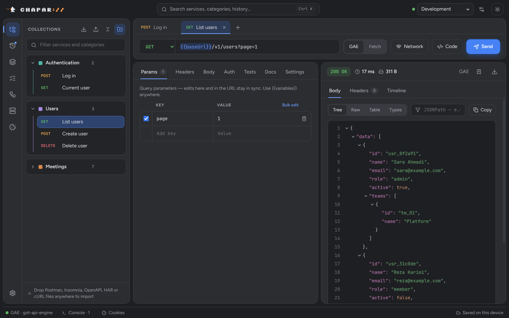
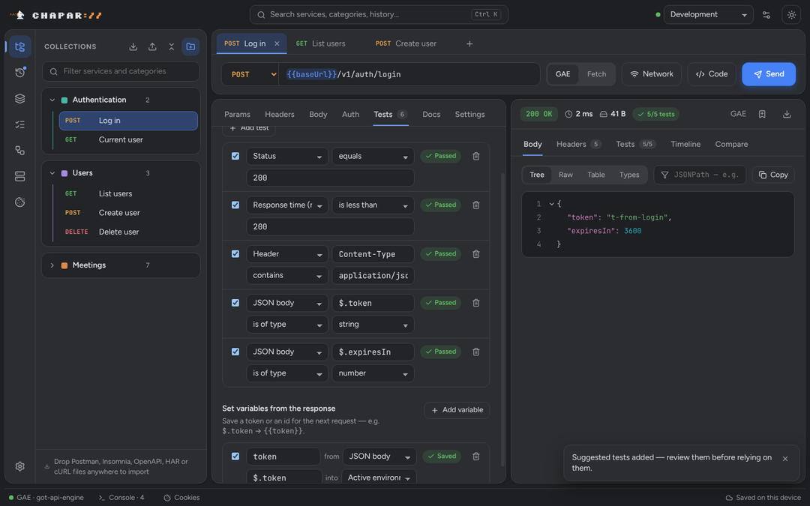
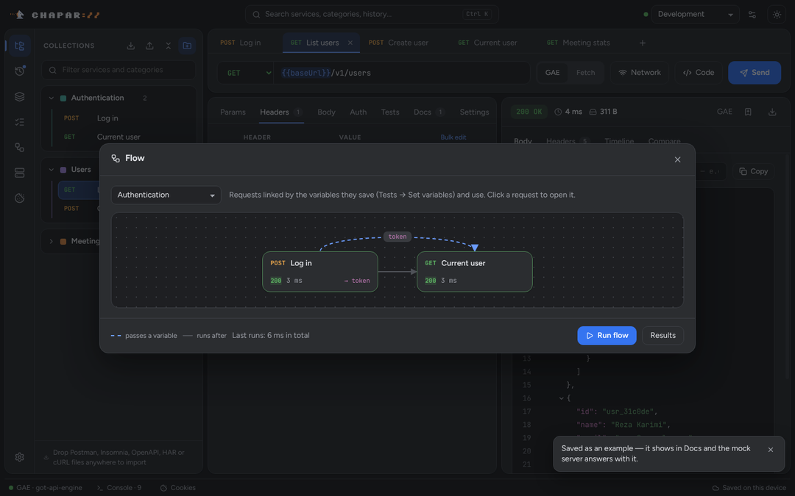
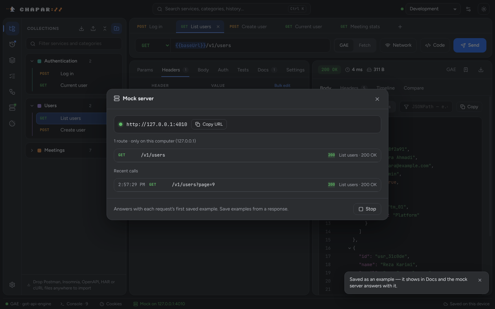
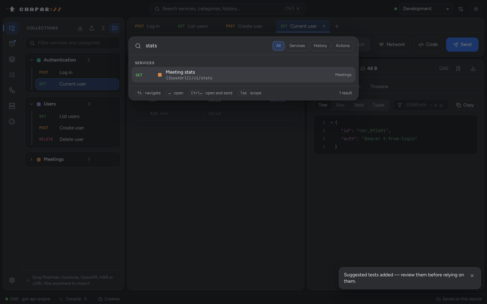
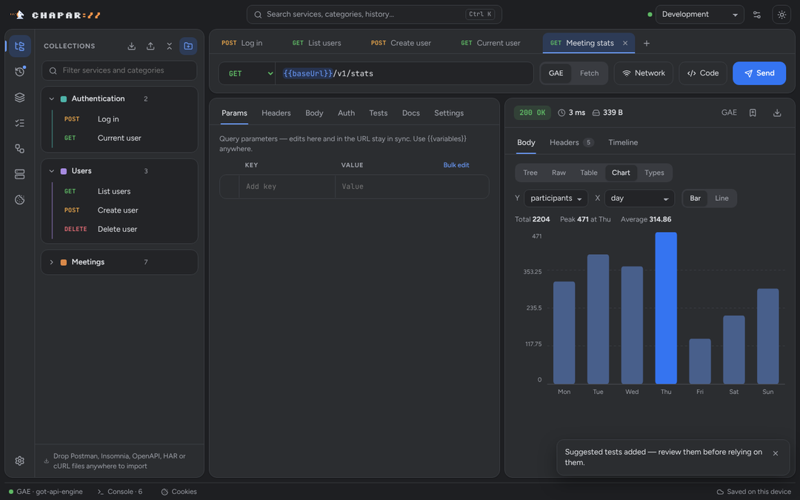
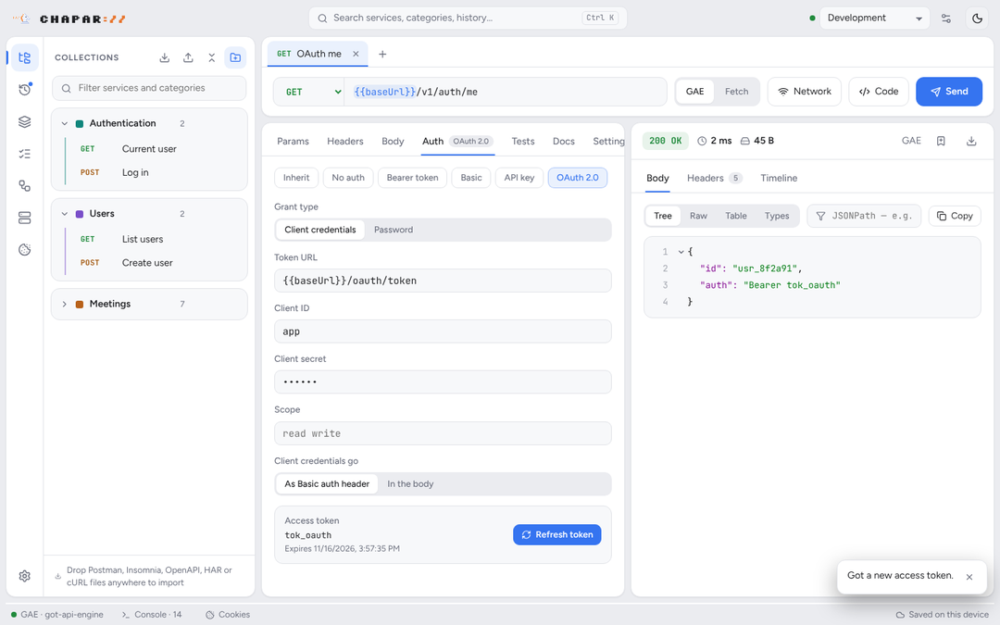

<h1 align="center">chapar://</h1>

<b>A fast, private API client for the desktop.</b> 
Build requests, test them, chain them and share them — without an account, without a cloud.

  
  
  

---

## Why Chapar

- **Yours, on your machine.** No sign-up, no workspace in someone else's cloud. Collections, environments and
  history are files on your computer; secrets are encrypted with your system keychain.
- **Fast to start, fast to use.** Open the app and send a request. Search everything with `Ctrl/⌘ K`, and every
  action has a shortcut.
- **Tests without scripts.** Write checks like _status is 200_ or _`$.user.id` exists_ by clicking — Chapar even
  suggests them from a response. Pass values to the next request without code.
- **Brings your work with it.** Import from Postman, Insomnia, HTTPie Desktop, OpenAPI / Swagger, HAR or cURL in one
  drop — and choose which folder the requests go into.

## Features

| | |
| --- | --- |
| **Connections** | WebSocket, Socket.IO, Server-Sent Events, MQTT and gRPC (server reflection or .proto; unary and streaming) with a live message log |
| **Requests** | Every HTTP method; JSON (editor or tree builder), form, multipart, raw, XML, binary and GraphQL bodies; URL ⇄ params kept in sync with encode/decode and array styles; `{{variable}}` suggestions as you type; bulk edit |
| **Auth** | Bearer, Basic, API key, OAuth 2.0 (client credentials, password) — per request or inherited from the folder. Tokens and passwords stay hidden until you click the eye |
| **Environments** | Variables per environment, globals and dynamic values (`{{$uuid}}`, `{{$timestamp}}`, `{{$randomEmail}}` …); secret values encrypted with the system keychain |
| **Two engines** | **GAE** (got-api-engine: retries, per-phase timings) and **Fetch** — switch with one click |
| **Responses** | Pretty, Tree (JSON and XML), Raw, Table and Chart views; HTML, image, SVG and PDF previews; cookies and timing; clear error cards with a suggested fix; compare with the previous run |
| **Types** | Models from a response in TypeScript, Zod, JSON Schema, Kotlin, Python, Java, Spring Boot, Go, C#, Swift and PHP |
| **Ask AI** | Explain, debug or write tests for a request — secrets hidden first; in Claude, ChatGPT or Gemini, or with your own key or a local Ollama model |
| **Testing** | Declarative tests, suggested from a response; extract values into variables; collection runner; **Flow** view of chained requests |
| **Mock server** | Serves the examples you saved, locally, so the front end can work before the back end is ready |
| **Network** | Simulated 4G / 3G / offline, cookie jar, system or custom proxy, custom CA, client certificates (mTLS), HTTP/2 |
| **Import** | Postman (collections and environments), Insomnia v4 / v5, HTTPie Desktop, OpenAPI 3 / Swagger 2 (JSON or YAML), HAR, cURL, Chapar |
| **Export** | Chapar, Collection v2.1, Markdown API docs; code for cURL, fetch, got-api-engine, axios, Python, OkHttp, RestTemplate, HTTPie and Go |
| **Comfort** | History, console, drag and drop, dark and light themes, confirmation before anything is deleted, in-app updates |

<table>
  <tr>
    <td> <b>Tests without scripts</b></td>
    <td> <b>Flow: see how requests feed each other</b></td>
  </tr>
  <tr>
    <td> <b>Local mock server</b></td>
    <td> <b>Search everything with Ctrl/⌘ K</b></td>
  </tr>
  <tr>
    <td> <b>Table and chart views of a response</b></td>
    <td> <b>Light theme</b></td>
  </tr>
</table>

## Download

Get the newest version from **[Releases → Latest](https://github.com/MJavadSF/chapar-studio/releases/latest)**.

| System | File |
| --- | --- |
| Windows 10 / 11 (64-bit) | `Chapar-x.y.z-win-x64.exe` |
| macOS, Apple Silicon (M1 and later) | `Chapar-x.y.z-mac-arm64.dmg` |
| macOS, Intel | `Chapar-x.y.z-mac-x64.dmg` |
| Linux, any distribution | `Chapar-x.y.z-linux-x86_64.AppImage` |
| Linux, Debian / Ubuntu | `chapar_x.y.z_amd64.deb` |

## Install

<b>Windows</b>

Run the installer and choose where to install. If SmartScreen shows a warning, click **More info → Run anyway**.

<b>macOS</b>

Open the `.dmg` and drag **Chapar** to **Applications**. macOS asks once before the first launch:

1. Open Chapar; macOS says it cannot verify the app.
2. Open **System Settings → Privacy & Security**, scroll down and click **Open Anyway**.

Or in Terminal: `xattr -dr com.apple.quarantine /Applications/Chapar.app`

<b>Linux</b>

- **AppImage:** `chmod +x Chapar-*.AppImage`, then run it.
- **Debian / Ubuntu:** `sudo apt install ./chapar_*.deb`

## Moving from another tool

Drag the exported file onto the Chapar window (or use **Import** in the sidebar). Chapar shows what it found and
lets you choose what to bring in.

| From | What to export |
| --- | --- |
| **Postman** | Collection (v2.0 or v2.1) and environments, as JSON |
| **Insomnia** | Data export (v4 JSON) or a v5 YAML collection |
| **HTTPie Desktop** | A request, a collection or a whole space, as JSON |
| **Swagger / OpenAPI** | The spec file, JSON or YAML (OpenAPI 3.x or Swagger 2.0) |
| **Browser DevTools** | Network tab → _Save all as HAR_ |
| **Terminal / docs** | Paste one or more cURL commands |

## Updates

Chapar checks this page for new versions and shows a notice in the app. On Windows and Linux it downloads only
what changed and installs when you restart; on macOS the notice opens the new download. Nothing is installed
without your click, and you can turn checking off in **Settings → About**.

## Privacy

- No account, no sign-in, no analytics.
- Your collections, environments and history stay on your computer.
- Secret variables are encrypted with your system keychain.
- The only network call Chapar makes on its own is the update check to GitHub — and you can turn it off.

## FAQ

**Is Chapar free?** Yes.

**Does it work offline?** Yes. Everything runs locally; you only need a network to reach the API you are testing.

**Can I share collections with my team?** Export as a Chapar or Postman v2.1 file and share it however you like —
in Git, a chat or a drive. Markdown docs are one click away too.

**Where do I report a problem or ask for a feature?** Open an
[issue](https://github.com/MJavadSF/chapar-studio/issues) in this repository.

## How Chapar compares

| | **Chapar** | **Postman** | **Insomnia** | **HTTPie Desktop** | **Swagger UI / Editor** |
| --- | :---: | :---: | :---: | :---: | :---: |
| What it is | Desktop API client | API platform | API client | API client (desktop, web, CLI) | OpenAPI docs and editor with a “try it out” console |
| Full use without an account | ✅ | ⚠️ lightweight client only | ⚠️ Scratch Pad only | ✅ | ✅ |
| Data stays on your machine by default | ✅ | ⚠️ local Git folders, after sign-in | ⚠️ depends on the storage you pick | ⚠️ synced when signed in | ✅ |
| Collections and environments | ✅ | ✅ | ✅ | ✅ | — |
| Tests | ✅ no code needed | ✅ JavaScript | ✅ JavaScript | — | — |
| Collection runner | ✅ | ✅ | ✅ | — | — |
| Visual flow of chained requests | ✅ | ✅ Flows | — | — | — |
| Mock server | ✅ local | ✅ cloud | ✅ | — | — |
| Simulated slow network (4G / 3G / offline) | ✅ | — | — | — | — |
| Imports HTTPie Desktop exports | ✅ | — | — | ✅ | — |
| Imports Postman, Insomnia, OpenAPI, HAR, cURL | ✅ all | ⚠️ most | ⚠️ most | ⚠️ some | ⚠️ OpenAPI only |
| Types / models from a response | ✅ 13 languages, incl. Spring Boot | — | — | — | — |
| AI assistant | ✅ your key, a local model or a chat app — secrets hidden first | ✅ Postman AI (50 credits a month free) | ⚠️ mock servers and commit messages | ✅ requests from plain language | — |
| OpenAPI design and documentation | ⚠️ import, Markdown docs | ✅ | ✅ | — | ✅ its focus |
| WebSocket, gRPC | ✅ | ✅ | ✅ | — | — |
| Socket.IO, Server-Sent Events, MQTT | ✅ | ⚠️ some | ⚠️ some | — | — |
| Price | Free | Free plan for one user, paid teams | Free plan, paid teams | Free | Free (open source) |

✅ yes · ⚠️ partly · — not offered or not its focus. Based on each product's public documentation as of
November 2026; products change, so check their sites for the latest.

**In short:** choose Postman for large teams that live in a shared cloud workspace, Swagger for designing and
publishing OpenAPI specs, Insomnia for an open-source client with Git or cloud sync, and HTTPie when you want the
same tool in the terminal and on the desktop. Choose **Chapar** when you want a quick, private client that keeps
everything on your machine and still does testing, chaining, mocks, network simulation and realtime connections —
plus types in 13 languages, a JSON tree builder, query encode/decode tools, error cards that explain what went
wrong, and AI help that never sends a secret you didn't choose to share.

<a href="https://github.com/MJavadSF/chapar-studio/releases/latest"><b>Download Chapar →</b></a>

